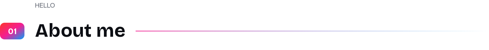
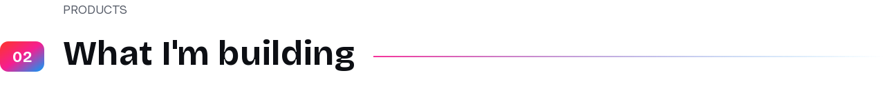
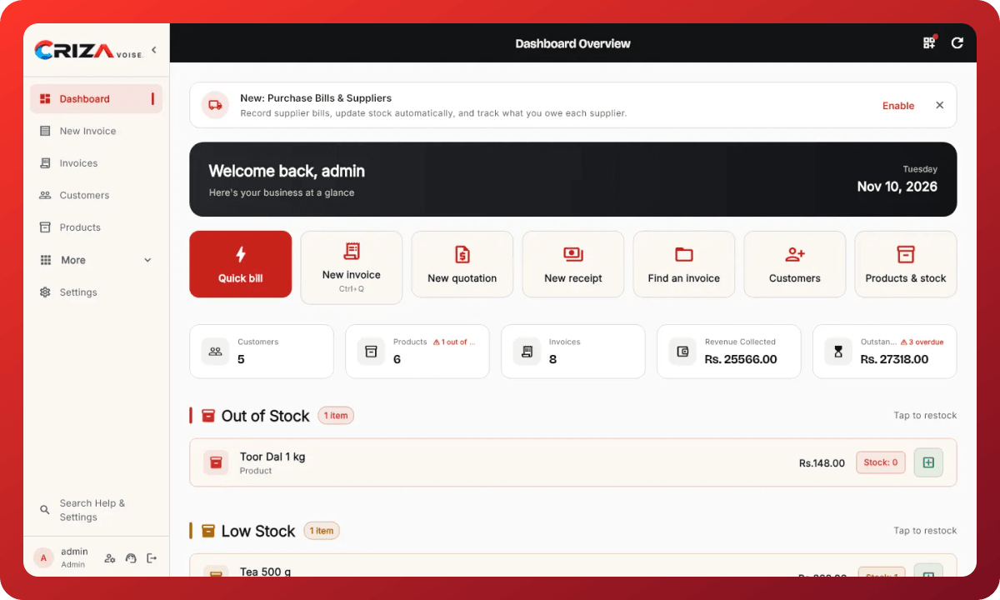
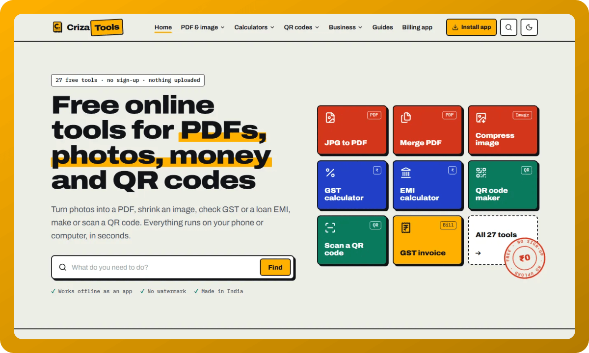
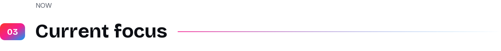
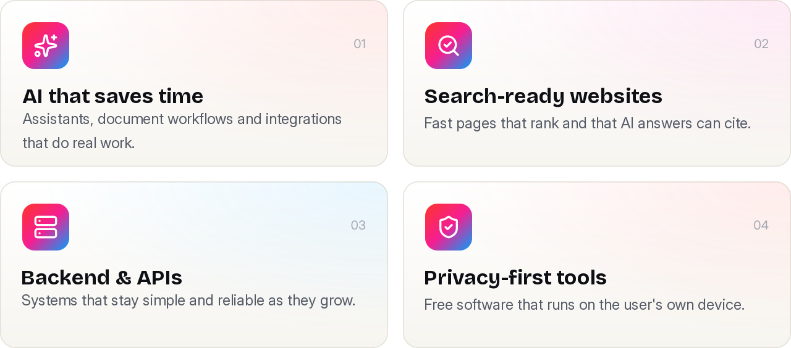
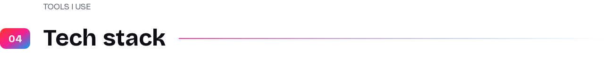
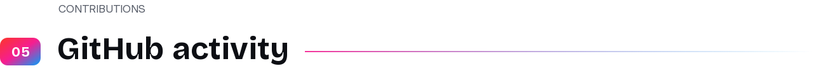
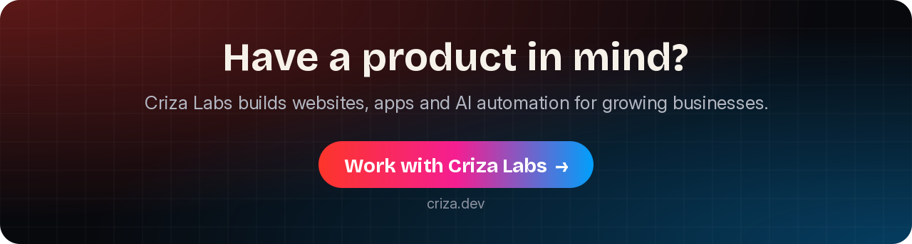

 
 

 

<picture>
  <source media="(prefers-color-scheme: dark)" srcset="https://raw.githubusercontent.com/AbraraliS/AbraraliS/main/assets/h-about-dark.png" />
  
</picture>

 

I'm a co-founder of **[Criza Labs](https://criza.dev)** and a full-stack and AI engineer. We build websites, web apps, mobile apps and AI automation for growing businesses, and the people who plan a project are the people who write the code.

Most of my work sits where product and engineering meet: designing the backend, wiring in AI where it actually helps, and shipping a frontend that stays fast on a phone.

 

<picture>
  <source media="(prefers-color-scheme: dark)" srcset="https://raw.githubusercontent.com/AbraraliS/AbraraliS/main/assets/h-building-dark.png" />
  
</picture>

 

<table>
  <tr>
    <td width="50%" valign="top">
      
      <h3>&nbsp; CrizaVoise</h3>
      <b>FREE, OPEN-SOURCE BILLING SOFTWARE</b>
      
GST invoices, quotations, thermal receipts, stock and payments for small businesses. It works fully offline on Windows, Linux and macOS, and the data stays on the user's computer.

      
  

      
<a href="https://voise.criza.dev"><b>Download free</b></a> &nbsp;&middot;&nbsp; <a href="https://github.com/CRIZA-LABS/crizavoise">Source code</a>

    </td>
    <td width="50%" valign="top">
      
      <h3>&nbsp; CrizaTools</h3>
      <b>27 FREE TOOLS THAT RUN IN YOUR BROWSER</b>
      
JPG to PDF, merge PDF, an image compressor, GST, EMI and SIP calculators, QR codes and a GST invoice generator. No sign-up, nothing uploaded, and it installs as an app that works offline.

      
  

      
<a href="https://criza.web.id"><b>Open CrizaTools</b></a>

    </td>
  </tr>
</table>

Also: <a href="https://criza.dev"><b>criza.dev</b></a>, the Criza Labs website, with free developer tools and guides.

 

<picture>
  <source media="(prefers-color-scheme: dark)" srcset="https://raw.githubusercontent.com/AbraraliS/AbraraliS/main/assets/h-focus-dark.png" />
  
</picture>

 

<picture>
  <source media="(prefers-color-scheme: dark)" srcset="https://raw.githubusercontent.com/AbraraliS/AbraraliS/main/assets/focus-dark.png" />
  
</picture>

 
 

<picture>
  <source media="(prefers-color-scheme: dark)" srcset="https://raw.githubusercontent.com/AbraraliS/AbraraliS/main/assets/h-stack-dark.png" />
  
</picture>

 

  
   
  
   
  

 
 

<picture>
  <source media="(prefers-color-scheme: dark)" srcset="https://raw.githubusercontent.com/AbraraliS/AbraraliS/main/assets/h-activity-dark.png" />
  
</picture>

 

  
  

 

<picture>
  <source media="(prefers-color-scheme: dark)" srcset="https://raw.githubusercontent.com/AbraraliS/AbraraliS/output/pacman-contribution-graph-dark.svg" />
  
</picture>

 
 

   
  

