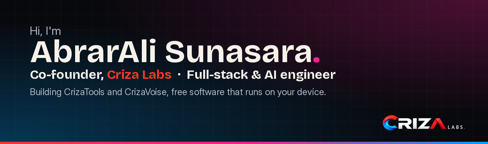

<div align="center">



<br />
<br />

<a href="https://www.linkedin.com/in/abraralis/"></a>
<a href="https://x.com/shadow07dev"></a>
<a href="https://www.youtube.com/@abraralis7"></a>
<a href="https://abrarali.vercel.app/"></a>
<a href="mailto:abrarali.sunasara28@gmail.com"></a>

</div>

<br />

## 👋 About me

I'm a co-founder of **[Criza Labs](https://criza.dev)** and a full-stack and AI engineer. We build websites, web apps, mobile apps and AI automation for growing businesses, and the people who plan a project are the people who write the code.

Most of my work sits where product and engineering meet: designing the backend, wiring in AI where it actually helps, and shipping a frontend that stays fast on a phone.

```js
const abrar = {
  role: ["Co-founder @ Criza Labs", "Full-stack engineer", "AI engineer"],
  building: ["CrizaTools", "CrizaVoise", "client websites, apps & automation"],
  likes: ["fast pages", "clean APIs", "software that works offline"],
  contact: "abrarali.sunasara28@gmail.com",
};
```

<br />

## 🚀 What I'm building

<table>
  <tr>
    <td width="50%" valign="top">
      <p>
        
        <b>&nbsp;CrizaTools</b><br />
        &nbsp;<sub>27 free tools that run in your browser</sub>
      </p>
      <a href="https://criza.web.id"></a>
      <p>JPG to PDF, merge PDF, an image compressor, GST, EMI and SIP calculators, QR codes and a GST invoice generator. Nothing is uploaded: PDFs are built in the page, photos are compressed with the canvas and QR codes are drawn on the device. It installs as an app and works offline.</p>
      <sub>Astro · Preact · Tailwind · Cloudflare Workers · PWA</sub><br /><br />
      <b><a href="https://criza.web.id">Open CrizaTools →</a></b>
    </td>
    <td width="50%" valign="top">
      <p>
        
        <b>&nbsp;CrizaVoise</b><br />
        &nbsp;<sub>Free, open-source billing software</sub>
      </p>
      <a href="https://voise.criza.dev"></a>
      <p>GST invoices, quotations, thermal receipts, stock and payments for small businesses, fully offline on Windows, Linux and macOS. The data stays on the user's computer.</p>
      <sub>Flutter · Dart · SQLite</sub><br /><br />
      <b><a href="https://voise.criza.dev">Download free →</a></b> &nbsp;·&nbsp; <a href="https://github.com/CRIZA-LABS/crizavoise">Source</a>
    </td>
  </tr>
</table>

<p align="center">
  Also: <a href="https://criza.dev"><b>criza.dev</b></a>, the Criza Labs website, with free developer tools and guides.
</p>

<br />

## 🧰 Tech stack

**Languages**<br />


**Frontend & mobile**<br />


**Backend & APIs**<br />


**Data & infrastructure**<br />


**Tools**<br />


<br />

## 🎯 Current focus

- AI features that save real time: assistants, document workflows and integrations
- Fast, search-ready websites that are also easy for AI answers to cite
- Backend systems and APIs that stay simple as they grow
- Free, privacy-first tools that run on the user's device

<br />

## 📊 GitHub activity

<div align="center">
  
  
</div>

<br />

<picture>
  <source media="(prefers-color-scheme: dark)" srcset="https://raw.githubusercontent.com/AbraraliS/AbraraliS/output/pacman-contribution-graph-dark.svg">
  <source media="(prefers-color-scheme: light)" srcset="https://raw.githubusercontent.com/AbraraliS/AbraraliS/output/pacman-contribution-graph.svg">
  
</picture>

<br />

<div align="center">

### Planning a website, an app or an automation?

<a href="https://criza.dev"></a>

<br />
<br />


</div>
